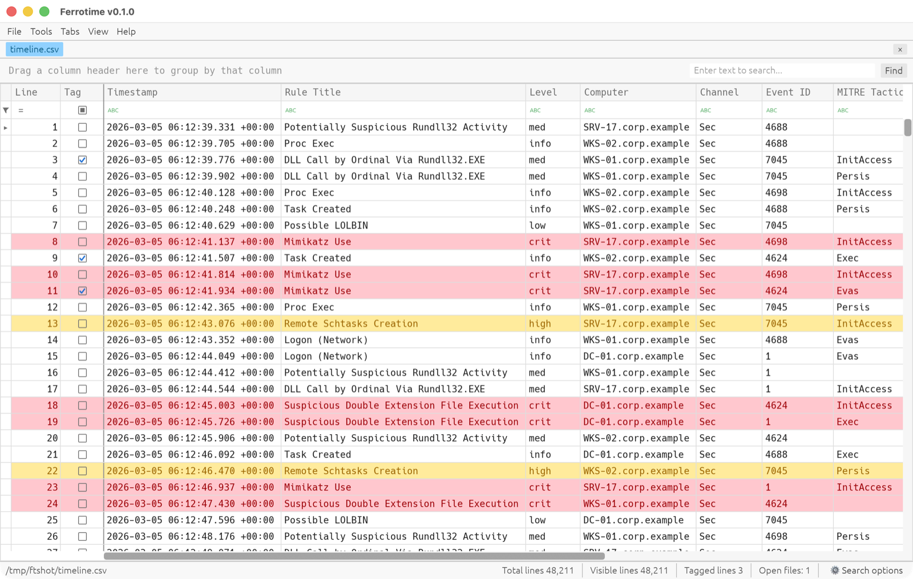
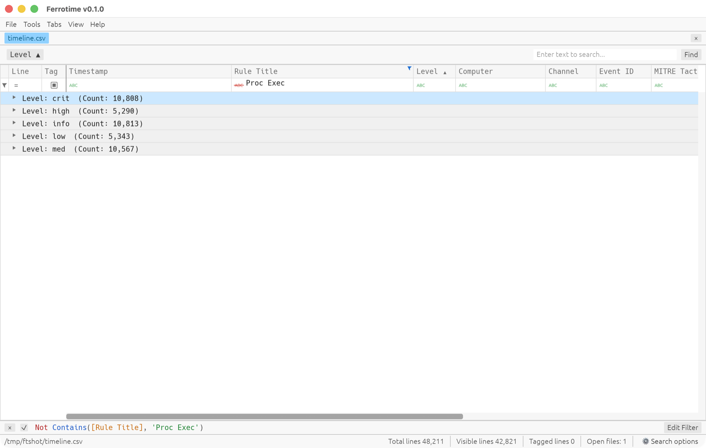

# Ferrotime

**Cross-platform timeline analysis for DFIR, written in Rust.**

Ferrotime is a fast viewer for forensic timelines and other large CSV/Excel files on macOS and Linux. It filters, searches, sorts, groups and tags millions of rows, and its layout and workflow follow [Timeline Explorer](https://ericzimmerman.github.io/) so analysts who use that tool on Windows feel at home.

> [!NOTE]
> Ferrotime is an independent project, **inspired by** Eric Zimmerman's Timeline Explorer. It is **not affiliated with, endorsed by, or supported by Eric Zimmerman**, and it contains no Timeline Explorer code. Please don't send Ferrotime questions or bug reports to him.

> [!WARNING]
> **No guarantee of accuracy.** Ferrotime has not been validated or certified for forensic, evidentiary or legal use, and it has not been tested against every file format, encoding or edge case. Filters, searches, sorting, tagging and session import may contain bugs that hide, misorder or misrepresent data. Verify any finding that matters against the original evidence or with another tool. The software is provided "as is", without warranty of any kind; see the [license](LICENSE).



## Features

- **Large files.** Loads multi-million-row CSVs in seconds; filtering and sorting run in the background on all CPU cores, so the window stays responsive.
- **Familiar layout.** Group-by box, search box, auto filter row, `Line` and `Tag` columns, filter bar with **Edit Filter**, status bar with *Total lines* / *Visible lines*, and **Search options**.
- **Filtering**
  - Auto filter row under the headers with 12 operators (equals, contains, does not contain, is like, begins with, greater than, …).
  - Header funnel with a **Values** checklist (with counts) and **Text Filters**; numeric and date columns default to a range, e.g. a time window.
  - **Filter Editor** with a syntax-highlighted criteria language (see [Filter language](#filter-language)); the filter bar can disable or clear the whole filter.
- **Search** in *Filter* behaviour (hide non-matching rows) or *Search* behaviour (highlight and jump with F3), with *Mixed*, *Or*, *And* and *Exact* match criteria (see [Search syntax](#search-syntax)).
- **Sorting** by clicking headers (Shift-click for multi-column sort), aware of numbers and timestamps.
- **Grouping** by dragging headers into the group-by box, with nested groups and per-group counts.
- **Tagging** rows, jumping between tagged rows, filtering on `[Tag]`, exporting tagged rows.
- **Conditional formatting** (*Highlight Cell Rules*, *Unique/Duplicate Rules*, *Manage Rules*), per cell or for the entire row.
- **Columns**: resize, best fit, reorder by dragging, hide via the Column Chooser, pin columns with *First scrollable column*.
- **Cell contents** window with *Format* / *Replace* (CRLF, CR, LF, comma, tab, `¦`) for long fields such as Hayabusa details.
- **Sessions**: save and restore open files with their filters, sorting, grouping, tags, layout and formatting. Timeline Explorer `.tle_sess` session files can be opened and saved too (see [Sharing sessions with Timeline Explorer](#sharing-sessions-with-timeline-explorer)).
- **Files**: CSV, TSV and other delimited text (delimiter detected automatically; UTF-8, UTF-16 and Windows-1252), plus Excel (`.xlsx`, `.xlsm`, `.xlsb`, `.xls`) and OpenDocument (`.ods`) spreadsheets.
- Light and dark skins, adjustable grid font size, copy cells or rows to the clipboard, export visible rows to CSV.



## Installation

There are no pre-built binaries yet; build from source with Rust **1.95 or newer** ([rustup](https://rustup.rs/)).

```sh
git clone https://github.com/jackcsk/ferrotime.git
cd ferrotime
cargo build --release
./target/release/ferrotime            # or: cargo run --release -- <files…>
```

### macOS

Install the Xcode command line tools (`xcode-select --install`). Nothing else is needed.

### Linux

Ferrotime uses X11 or Wayland and renders with Vulkan or OpenGL. On Debian/Ubuntu:

```sh
# build dependencies
sudo apt install build-essential pkg-config libxkbcommon-dev libwayland-dev \
  libx11-dev libxcursor-dev libxrandr-dev libxi-dev libgl1-mesa-dev
# runtime dependency (preinstalled on most desktops)
sudo apt install libxkbcommon-x11-0
```

The Open/Save dialogs use the desktop's [XDG Desktop Portal](https://flatpak.github.io/xdg-desktop-portal/) (`xdg-desktop-portal` plus a backend such as `xdg-desktop-portal-gtk` or `-kde`), which standard GNOME and KDE desktops already provide.

## Usage

Open files with **File ▸ Open…**, by dropping them on the window, or from the command line:

```sh
ferrotime timeline.csv evtx.csv                # each file opens in its own tab
ferrotime case.ferrotime                       # restore a Ferrotime session
ferrotime case.tle_sess                        # open a Timeline Explorer session
```

The first row of a file is used as the column headers. Two columns are added on the left: `Line` (the 1-based row number in the file) and `Tag`.

### Keyboard shortcuts

`⌘` on macOS is `Ctrl` on Linux. **Help ▸ Keyboard shortcuts** shows the same list in the app.

| Shortcut | Action |
|---|---|
| `⌘O` / `⌘W` | Open file / close tab |
| `⌘F` | Focus the search box |
| `F3` / `Shift+F3` | Next / previous search match (*Search* behaviour) |
| `⌘T` or `Space` | Tag or untag the selected rows |
| `⌘]` / `⌘[` | Next / previous tagged row |
| `⌘G` | Go to line |
| `Shift+⌘E` | Open the Filter Editor |
| `⌘C` | Copy the cell (or the rows, when several are selected) |
| `Shift+⌘C` | Copy the selected rows with a header row |
| `⌘A` | Select all rows |
| `Enter` / double-click | Show cell contents; expand or collapse a group |
| `←` / `→` | Move between cells; collapse or expand a group |
| `+` / `-` | Expand / collapse all groups |
| `Shift`+click header | Add the column to a multi-column sort |
| `⌘`+click header | Remove the column from the sort |
| `Ctrl+Tab` / `Ctrl+Shift+Tab` | Next / previous tab |

### Filter language

The filter bar and the Filter Editor use a criteria language in the style of Timeline Explorer's (DevExpress) filters. Column filters you set in the auto filter row or header popups appear here too, joined with `And`.

```text
Not Contains([Rule Title], 'Proc Exec') And [Level] In ('high', 'crit')
[Timestamp] Between('2026-03-05 06:00:00', '2026-03-05 07:00:00')
[Event ID] >= 4624 And Not IsNullOrEmpty([Computer]) And [Tag] = true
```

| Form | Meaning |
|---|---|
| `[Column]` | A column by header name; `[Line]` and `[Tag]` refer to the added columns |
| `'text'` | A value (`''` is an escaped quote); bare numbers and `true`/`false` are allowed |
| `=` `<>` `<` `<=` `>` `>=` | Compare; numerically if both sides are numbers, chronologically if both are timestamps, otherwise as case-insensitive text |
| `[C] Between('a', 'b')` | Inclusive range, with the same comparison rules |
| `[C] In ('a', 'b')` | Exact match against a list (as built by the Values checklist) |
| `[C] Like 'pat'` | Whole-value match with `%` (any run) and `_` (one character), case-insensitive |
| `Contains`, `StartsWith`, `EndsWith` `([C], 'text')` | Case-insensitive substring tests |
| `Regex([C], 'pattern')` | Regular expression, case-insensitive unless the pattern starts with `(?-i)` |
| `IsNullOrEmpty([C])` | Blank cells |
| `Not`, `And`, `Or`, `( )` | Logic, in that order of precedence |

### Search syntax

The search box follows **Search options** at the bottom right. With the default *Mixed* match criteria:

| Search | Matches rows that… |
|---|---|
| `mimikatz` | contain `mimikatz` in any column |
| `one two three` | contain any of the words |
| `"bad guy"` | contain the phrase |
| `mimikatz +"bad guy"` | contain `mimikatz` **and** `bad guy` |
| `data +entry -mark` | contain `data` and `entry`, but not `mark` |
| `Computer:dc-01 4624` | have `dc-01` in the column whose header starts with `Computer`, **and** `4624` anywhere |
| `import -User:steve` | contain `import`, excluding rows with `steve` in the `User…` column |

*Or*, *And* and *Exact* split the text into words (or keep it whole for *Exact*) and apply the selected *Condition*: contains, starts with, like (`*`/`%` and `?`/`_` wildcards) or equals. All matching ignores case.

### Sharing sessions with Timeline Explorer

Ferrotime has its own session format (`.ferrotime`, JSON) that stores everything about each tab. It can also open and save Timeline Explorer's `.tle_sess` files, so Windows and macOS/Linux analysts can exchange sessions:

- A `.tle_sess` file holds only the **open files and their tagged line numbers**. Filters, sorting, grouping and layout are not part of that format.
- **Opening** (File ▸ Session ▸ Load…, drag-and-drop, or the command line): Ferrotime tries each recorded path as-is. If a file is not there, which is usual for paths such as `C:\Cases\case\out\evtx.csv` recorded on Windows, it looks below the session file's folder, matching the end of the recorded path (`<session folder>/out/evtx.csv`, then `<session folder>/evtx.csv`). Keep the CSVs alongside the session file and it opens on either platform. Files that still can't be found are listed.
- **Saving** (File ▸ Session ▸ Save as Timeline Explorer session…) writes the same JSON layout Timeline Explorer writes. Timeline Explorer skips files whose recorded path doesn't exist on that machine, so a session saved on macOS or Linux opens on Windows only if the files are at the same paths there.
- Tags line up between the two tools because both number rows from 1 in file order. Both sides must open the same version of each file.

## Performance

On an Apple Silicon Mac, a 424 MB CSV with 2 million rows opens in under 4 seconds, and sorting or grouping it takes about 2 seconds. Cell text is kept in one compact buffer, so memory use is about 1.2× the file size.

## Contributing

Bug reports, feature requests and pull requests are welcome; see [CONTRIBUTING.md](CONTRIBUTING.md). Please report security issues privately as described in [SECURITY.md](SECURITY.md).

## Acknowledgements

- [Eric Zimmerman](https://ericzimmerman.github.io/), whose Timeline Explorer this project is modelled on.
- [egui / eframe](https://github.com/emilk/egui) for the user interface, and the other crates listed in [`Cargo.toml`](Cargo.toml).

"Timeline Explorer" is the name of Eric Zimmerman's software and is used here only to describe compatibility and inspiration.

## Disclaimer

Ferrotime is provided "as is", without warranty of any kind, express or implied, including fitness for any particular purpose such as forensic examination or use as evidence. The authors make no guarantee that its output is complete or correct and accept no liability for decisions, findings or proceedings based on it. Analysts remain responsible for validating their tools and results under their own methodology and legal requirements.

## License

[MIT](LICENSE)
